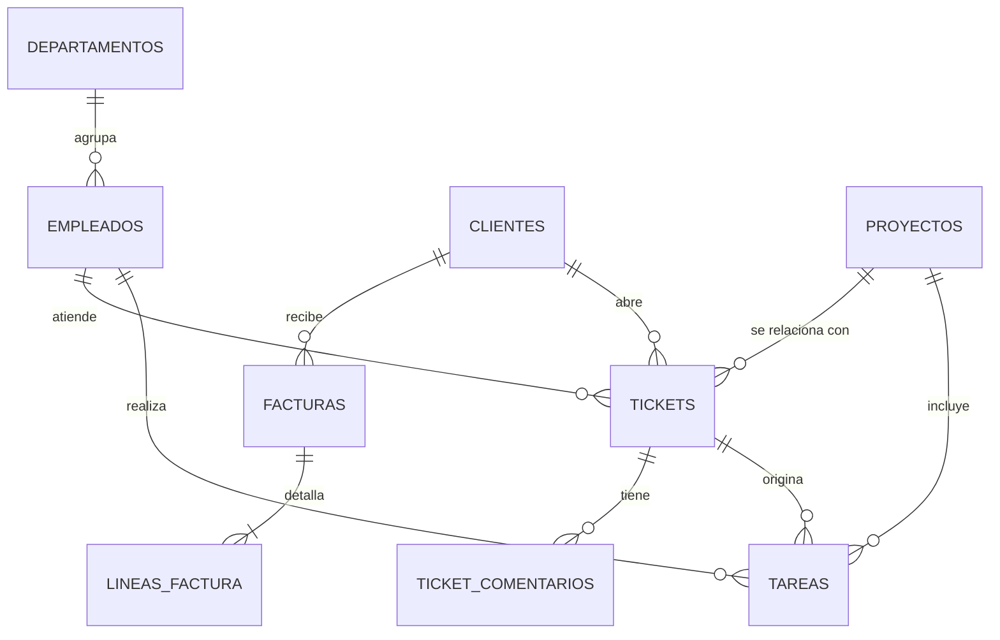

# Mejora futura 02 — Aplicación de gestión centralizada, ampliación del diseño de datos y blog corporativo

- **Estado:** propuesta documentada (diseño de datos incluido), **no implementada** en esta versión del proyecto.
- **Origen:** feedback recibido al revisar este proyecto intermodular.
- **Afecta a:** [Módulo 4](../modulo4-base-datos/README.md) · [Módulo 2](../modulo2-sistemas-operativos/README.md) · [Módulo 5](../modulo5-documentacion-web/README.md) · [Módulo 6](../modulo6-cloud-aws/README.md)

> *Agradecimiento especial a la profesora Olga M. por la observación. Me hizo considerar el hecho de que mi base de datos sustenta bien el **trabajo técnico** de `VectorSec`, pero todavía no el **negocio** alrededor (clientes que se comunican, facturas, tareas, departamentos). Lo menciono aquí con el mismo criterio que usé con la DMZ, diseñarlo con rigor y decir con claridad qué es lo que queda fuera.*

---

## 1. De qué se trata (en corto)

Del comentario salen **tres piezas distintas**, y considero mejor no mezclarlas:

1. **Ampliar el diseño de datos** (Módulo 4): departamentos, facturación, tickets de clientes y tareas de empleados.
2. **Una aplicación de gestión** que use esos datos: pantallas, usuarios, formularios. Aquí ya estamos hablando de **desarrollo de software**.
3. **Un blog en WordPress** para que la empresa se posicione en buscadores (SEO/SEM). Eso es **marketing**, no administración de sistemas.

Haciendo una analogía, sería como decir que la base de datos es **el archivo del almacén** (qué hay y dónde); la aplicación es **el mostrador** donde clientes y empleados piden y consultan cosas; el blog es **el escaparate** que atrae gente de la calle. Digamos que yo he construido el almacén. El mostrador y el escaparate necesitan de otros especialistas.

## 2. Dónde estamos ahora mismo

| Pieza | Estado | Dónde está |
| :--- | :--- | :--- |
| Base de datos `vectorsec_gestion` | **Hecha**: 7 tablas, roles sin `DELETE`, backup al NAS | [Módulo 4](../modulo4-base-datos/README.md) |
| Cuenta de servicio `app_vectorsec` | **Creada** con acceso completo | [SRV-APP01](../modulo2-sistemas-operativos/servidores/SRV-APP01.md) |
| Aplicación de gestión | **No existe** | Solo se menciona como consumidora de la BD |
| Facturación, tickets, tareas, departamentos | **No modelados** | — |
| Comunicación cliente → empresa | Solo el portal de **consulta** de informes (lectura) | [Módulo 6](../modulo6-cloud-aws/README.md) |
| Blog / SEO | **No existe**; la web corporativa es estática | [Módulo 5](../modulo5-documentacion-web/README.md) |

## Un poquito de honestidad

Mis README de los Módulos 2 y 4 dicen que la base de datos "sustenta la aplicación de gestión interna" alojada en `SRV-APP01`. Es cierto **como diseño** (la cuenta `app_vectorsec` y los permisos están preparados), pero **la aplicación como tal no está desarrollada**. *Lo dejo escrito aquí para que nadie lo lea como si estuviera funcionando*. Y el portal del Módulo 6 hoy es de **solo lectura** y de **un solo sentido** (on-premise → nube): los clientes pueden *ver* informes, no *escribir* a `VectorSec`.

## 3. Propuesta

### 3.1 Diseño de datos (Módulo 4)

Mantengo las **mismas convenciones** que el resto del esquema: `SERIAL` como clave, enumeraciones con `CHECK` (sin tildes, como `Critica`), **nada de `DELETE`** (se cambia el `estado`) y `usuario_ad` para enlazar con Active Directory en vez de duplicar identidades.

| Tabla nueva | Para qué sirve | Relaciones |
| :--- | :--- | :--- |
| `departamentos` | Los 6 departamentos de la empresa (Recepción, Administración, Dirección, Desarrollo, Soporte Técnico, Aula de Formación) | 1 departamento → N empleados |
| `facturas` | Cabecera de factura: número, fecha, estado (`Borrador`, `Emitida`, `Pagada`, `Anulada`) | N facturas → 1 cliente; opcional 1 proyecto |
| `lineas_factura` | Detalle de cada factura: concepto, cantidad, precio, IVA | N líneas → 1 factura; opcional 1 servicio |
| `tickets` | Lo que el cliente comunica: `Incidencia`, `Presupuesto`, `Cambio`, `Consulta`, con prioridad y estado | N tickets → 1 cliente; opcional 1 proyecto; asignado a 1 empleado |
| `ticket_comentarios` | Conversación dentro de un ticket (el hilo cliente ↔ empleado) | N comentarios → 1 ticket |
| `tareas` | Trabajo asignado a empleados, con fecha límite y estado | N tareas → 1 empleado; opcional 1 proyecto; opcional 1 ticket |

Además, un cambio sobre una tabla existente: `empleados` ganaría una columna `id_departamento` (clave foránea a `departamentos`).



Un esquema de las dos tablas más delicadas, para mostrar que el diseño se ha pensado:

```sql
CREATE TABLE tickets (
    id_ticket     SERIAL PRIMARY KEY,
    id_cliente    INTEGER NOT NULL REFERENCES clientes(id_cliente),
    id_proyecto   INTEGER REFERENCES proyectos(id_proyecto),
    id_empleado   INTEGER REFERENCES empleados(id_empleado),   -- quién lo atiende
    tipo          VARCHAR(20) NOT NULL
                  CHECK (tipo IN ('Incidencia','Presupuesto','Cambio','Consulta')),
    prioridad     VARCHAR(10) NOT NULL DEFAULT 'Media'
                  CHECK (prioridad IN ('Baja','Media','Alta','Urgente')),
    estado        VARCHAR(20) NOT NULL DEFAULT 'Abierto'
                  CHECK (estado IN ('Abierto','En curso','Resuelto','Cerrado')),
    asunto        VARCHAR(150) NOT NULL,
    descripcion   TEXT NOT NULL,
    fecha_alta    TIMESTAMP NOT NULL DEFAULT CURRENT_TIMESTAMP
);

CREATE TABLE tareas (
    id_tarea      SERIAL PRIMARY KEY,
    id_empleado   INTEGER NOT NULL REFERENCES empleados(id_empleado),
    id_proyecto   INTEGER REFERENCES proyectos(id_proyecto),
    id_ticket     INTEGER REFERENCES tickets(id_ticket),
    descripcion   VARCHAR(200) NOT NULL,
    fecha_limite  DATE,
    estado        VARCHAR(20) NOT NULL DEFAULT 'Pendiente'
                  CHECK (estado IN ('Pendiente','En curso','Hecha','Cancelada'))
);
```

> *Esto es un **planteamiento de diseño**, no un script que haya podido verificar, no lo he ejecutado contra PostgreSQL como sí hice con los cuatro scripts del Módulo 4. Antes de implementarlo habría que probarlo, añadir índices y datos de ejemplo.*

**Permisos:** Seguiría el criterio actual, es decir, `rol_lectura` solo consulta; `rol_consultor` crearía y actualizaría `tickets`, `tareas` y comentarios; la **facturación** quedaría solo para un rol administrativo nuevo (`rol_administracion`), porque un consultor no debería tocar facturas. Eso si, **nadie borra**, se anula o se cierra.

### 3.2 Aplicación de gestión (Módulos 2 y 6)

- **Dónde vive:** en `SRV-APP01`, que ya existe y ya tiene el firewall (UFW) y la cuenta `app_vectorsec` ([Módulo 2](../modulo2-sistemas-operativos/servidores/SRV-APP01.md)). Para empleados, acceso solo desde la LAN.
- **Qué haría:** gestionar clientes, proyectos, facturas, tickets y tareas. Los empleados entrarían con su usuario de **Active Directory**, y la aplicación aplicaría los permisos por rol (igual que ya anticipa `04_usuarios_permisos.sql`).
- **Para los clientes:** ampliar el portal del [Módulo 6](../modulo6-cloud-aws/README.md) para que puedan **abrir tickets** (avería, presupuesto, cambio), no solo descargar informes. Aquí hay un detalle de diseño que quiero resaltar: hoy el flujo es *solo* de la oficina hacia la nube. Un ticket haría el camino **contrario** (nube → oficina). Mi propuesta es que **la oficina vaya a buscar** los tickets nuevos (por ejemplo, desde una cola), en lugar de abrir un puerto hacia dentro. De esa manera se mantiene la regla de oro del proyecto: **los datos sensibles nunca salen, y la nube no puede entrar**.
- **Autenticación de clientes:** la gestionaría un servicio de identidad en la nube, **sin guardar contraseñas de clientes en `vectorsec_gestion`**. *(Es una propuesta mía, no algo que de por decidido ni probado.)*

| Módulo | Qué cambiaría |
| :--- | :--- |
| [Módulo 4: BBDD](../modulo4-base-datos/README.md#4-modelo-relacional) | Nuevas tablas, la columna `id_departamento`, nuevos roles y scripts adicionales (`05_…`). Habría que **actualizar el diagrama E-R**. |
| [Módulo 2: Sistemas Operativos](../modulo2-sistemas-operativos/servidores/SRV-APP01.md) | Instalar la aplicación en `SRV-APP01` y abrir en UFW solo el puerto necesario, igual que con PostgreSQL. |
| [Módulo 5: Documentación web](../modulo5-documentacion-web/README.md) | Valorar si el XML/XSD debe incluir facturas o tickets. **Solo si hace falta**: hoy exporta proyectos finalizados y funciona. |
| [Módulo 6: Cloud](../modulo6-cloud-aws/README.md) | Ampliar el portal con la entrada de tickets y el flujo inverso, sin exponer la base de datos interna. |

### 3.3 Blog en WordPress

- **Qué es y para qué:** un blog con artículos sobre ciberseguridad para pymes, que atraiga visitas por buscadores (SEO) y permita anunciarse (SEM).
- **Dónde:** en la nube, **separado del portal de clientes** y sin ninguna conexión con la base de datos interna ni con el RDS del portal. Un blog público es un objetivo habitual de ataques, así que debe poder caer sin arrastrar nada más: es la misma lógica de aislamiento de la DMZ de la [mejora 01](./01-dmz-y-firewall-de-host.md).
- **Qué parte es mía:** el alojamiento, el bastionado (HTTPS, actualizaciones, copias, acceso de administración restringido). **Qué parte no:** redactar contenidos, estrategia de palabras clave y campañas, que son del área de marketing.
- **Relación con lo que ya hay:** la web corporativa estática del [Módulo 5](../modulo5-documentacion-web/README.md) seguiría siendo la "tarjeta de presentación"; el blog se enlazaría desde ella.

## 4. Por qué la dejo como mejora futura y no la implemento ahora

- **La aplicación es desarrollo de software:** Hacerla bien exige programación, pruebas y mantenimiento de código, que no corresponde con ASIR. Una aplicación a medias dañaría más la credibilidad del proyecto, **que no tenerla**.
- **El blog es marketing:** El valor del SEO está en el contenido y la constancia, no en la infraestructura.
- **Coste de coherencia:** Tocar el Módulo 4, me obligaría a repasar los Módulos 2, 5 y 6, que ya están cerrados y verificados (scripts, XSD con `xmllint`, arquitectura cloud). Prefiero un diseño honesto y cerrado que una ampliación a medias sin poder probarla con el mismo rigor.
- **Prioridades:** Tengo por delante las prácticas profesionales, el proyecto final y los exámenes. Es mejor cerrar bien lo que ya tengo.

## 5. Cómo lo defendería, en tres frases

> `VectorSec` tiene hoy el archivo de datos bien diseñado y protegido (roles, copias, segmentación de red), pero no una aplicación que lo explote. He diseñado la ampliación de datos (facturas, tickets, tareas, departamentos) siguiendo las mismas reglas del esquema actual, y he decidido no desarrollar la aplicación porque es trabajo de desarrollo y no de administración de sistemas. Si la empresa la necesitara mañana, la infraestructura ya está preparada para alojarla y el diseño de datos ya está pensado.

## 6. Orden de implementación sugerido

1. Probar y cerrar los scripts SQL de las nuevas tablas en el Módulo 4 (más datos de ejemplo e índices), y actualizar el diagrama E-R.
2. Añadir `rol_administracion` y ajustar los permisos existentes.
3. Aplicación interna mínima en `SRV-APP01` (por ejemplo, tickets y tareas primero, facturas después), con los usuarios de AD.
4. Ampliar el portal del Módulo 6 con la entrada de tickets y el flujo nube → oficina.
5. Valorar el XML/XSD solo si las nuevas entidades tienen que exportarse.
6. Blog en WordPress, aislado y bastionado, **al final**, porque es lo menos crítico.
